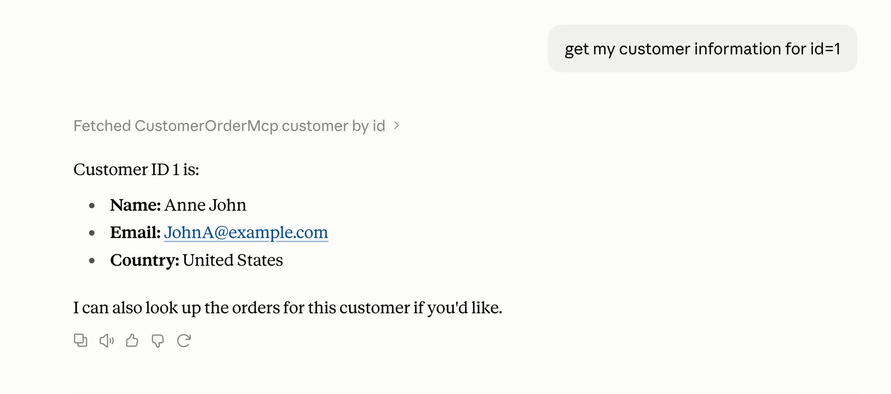
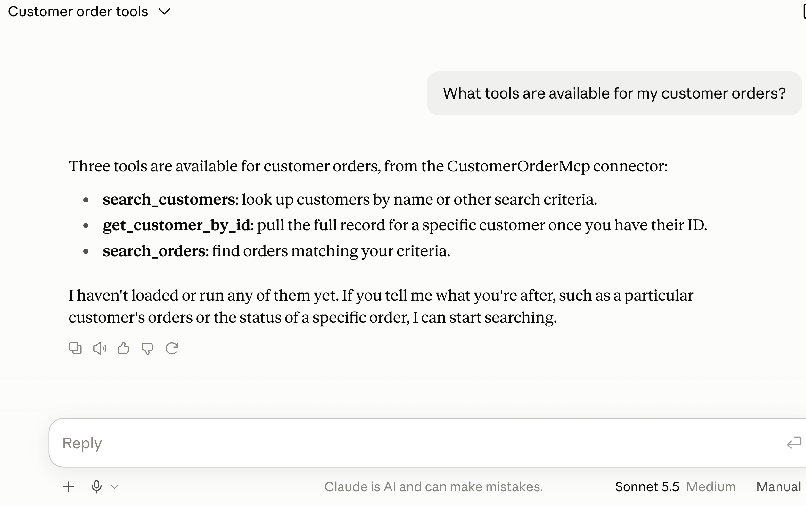
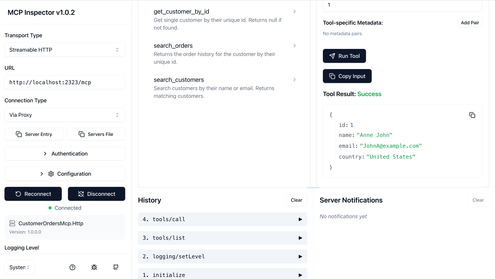
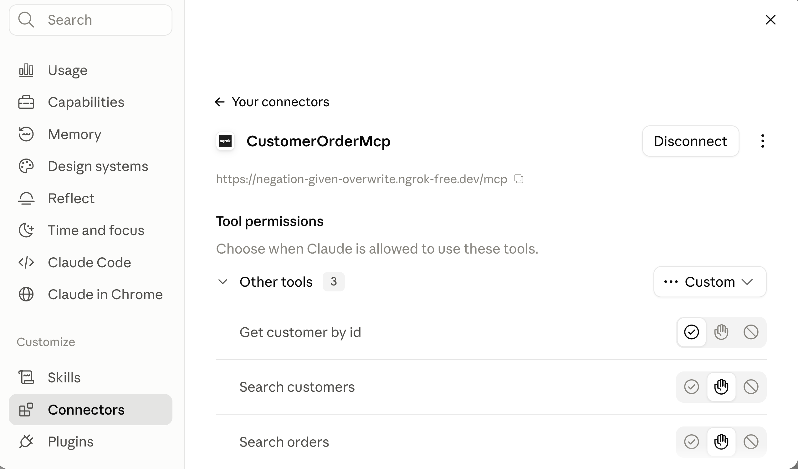

# CustomerOrdersMcp.Http

An HTTP-based MCP (Model Context Protocol) server that exposes customer and order data to AI assistants like Claude. Demonstrates clean API design, repository patterns, and integration with AI tooling.

## Overview

This project solves the problem of giving AI assistants safe, structured access to internal business data. The **Model Context Protocol** is a standard that lets AI models call tools on your systems—think of it as an API specification for AI.

Instead of copying data into ChatGPT or Claude, you run this server and connect Claude directly to your customer database. Claude can query customer info, search by name/email, and retrieve order history—all with the exact data from your system, nothing leaked.

## Key Features

- **3 MCP Tools** – Get customer by ID, search customers, fetch order history
- **HTTP Transport** – Runs as a web server (easily proxied via ngrok or deployed)
- **In-Memory Repository** – Sample data with 4 customers, 4 orders (extensible to real databases)
- **Health Check** – `/healthz` endpoint for monitoring
- **Clean Architecture** – Separation of data (Repository), tools (MCP definitions), and HTTP concerns

## Tech Stack

- **.NET 10.0** (latest)
- **ASP.NET Core** (minimal APIs)
- **ModelContextProtocol.AspNetCore 2.2.0**
- In-memory LINQ queries (no external DB required)

## Architecture

```
Claude / AI Client
       ↓
  MCP Proxy (ngrok or local)
       ↓
HTTP Server (localhost:2323)
       ↓
 CustomerTools (MCP Tool Definitions)
       ↓
CustomerRepository (In-Memory Data)
```

The repository holds sample customers and orders. Tools wrap repository methods and expose them as MCP-compatible callables. The HTTP server handles the MCP protocol transport.

## Getting Started

**Prerequisites:** .NET 10.0 SDK or later

### 1. Clone and setup

```bash
# Clone and navigate
git clone <repo-url>
cd CustomerOrdersMcp.Http

# Copy environment template
cp .env.example .env
# Edit .env with your local settings (optional - defaults work)
```

### 2. Configure environment (optional)

Edit `.env` to customize:
```env
SERVER_PORT=2323          # Port to run on
SERVER_HOST=localhost     # Host to bind to
MCP_PROXY_URL=http://localhost:6274
```

### 3. Build and run

```bash
dotnet run
# Server listens on http://localhost:2323
```

**Connect to Claude Desktop:**

Add to `~/Library/Application Support/Claude/claude_desktop_config.json`:

```json
{
  "mcpServers": {
    "customer-orders": {
      "command": "dotnet",
      "args": ["run", "--project", "/path/to/CustomerOrdersMcp.Http"]
    }
  }
}
```

**Or use ngrok for remote access:**

```bash
ngrok http 2323
# Copy the ngrok URL (e.g., https://xxx.ngrok-free.dev/mcp)
# Add to Claude's connector settings
```

### Environment Variables

The app reads from a `.env` file (not committed to git). All variables are optional with sensible defaults:

```env
SERVER_PORT=2323              # Port to run on (default: 2323)
SERVER_HOST=localhost         # Host to bind to (default: localhost)
MCP_PROXY_URL=...            # MCP proxy URL (for reference)
```

**Security note:** Never commit `.env` to GitHub. The `.gitignore` excludes it automatically. Use `.env.example` as a template for new developers.

## Example Usage

**Prompt:**  
"Get my customer information for id=1"

**Expected:**  
Claude calls `get_customer_by_id(1)` → returns Anne John's details (name, email, country).



**Prompt:**  
"What tools are available for my customer orders?"

**Expected:**  
Claude lists the three tools: `get_customer_by_id`, `search_customers`, `search_orders`.



**Prompt:**  
"Find orders for customer 1"

**Expected:**  
Claude calls `search_orders(1)` → returns two orders (Annual Cloud Plan, Training Workshop).

## Setup in Action

**MCP Inspector** showing connected tools:


**Claude Connectors** page with ngrok URL:


---

**Status:** Working proof of concept. Connect via Claude Desktop or ngrok proxy.
